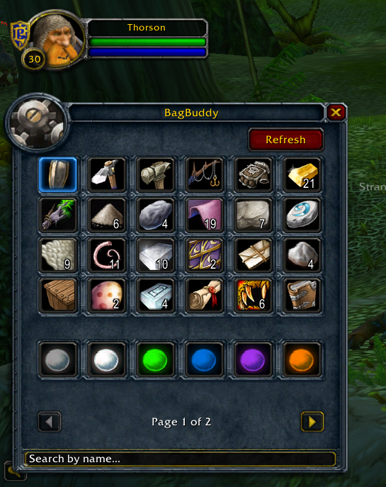
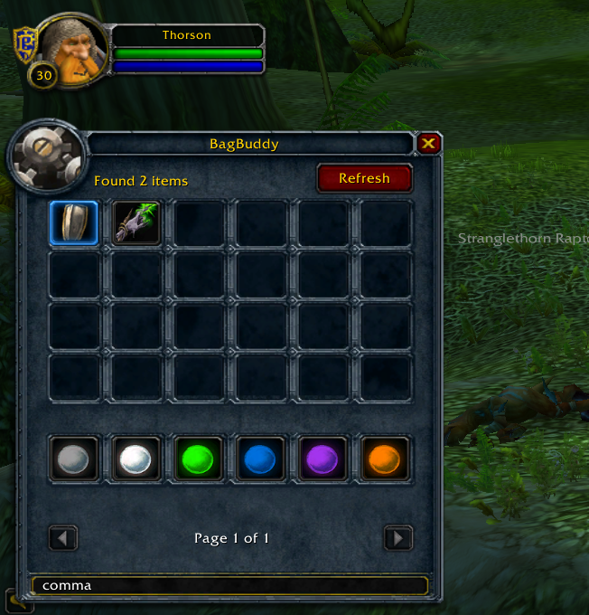
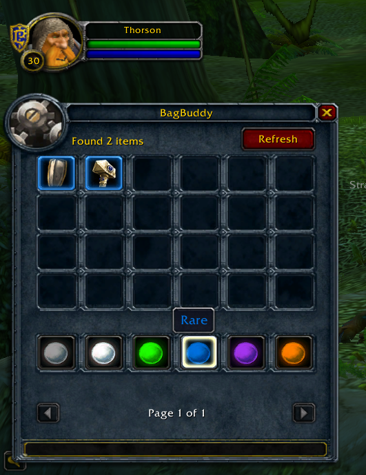

# BagBuddy 1.12.1

**Filter and search for items in your bag.**

---

## About

BagBuddy was originally created by **James Whitehead II** and **Rick Roe**, the authors of the *World of Warcraft Programming* book, which includes a step-by-step guide to building this AddOn yourself.

The tutorial assumes you're developing on the **3.3.5a** client. If you're on a different client version, some workarounds are needed. This version is adapted to **1.12.1**, which should help anyone trying to do the same.

## Features

- Search items in your bag by name
- Filter items by quality

## Screenshots

### Main Panel

### Search by Name

### Filter by Quality

## Sources

- [World of Warcraft Programming (PDF)](https://protokolo7.neocities.org/lua/WoW_Addons.pdf)
- The BagBuddy tutorial runs from chapter 9 (page 143) through chapter 14 (page 265).

## Special Thanks

- James Whitehead II
- Rick Roe

## Support Their Work

If you find the book useful, consider [buying a copy on Amazon](https://www.amazon.com/dp/B0011UCOHK).
